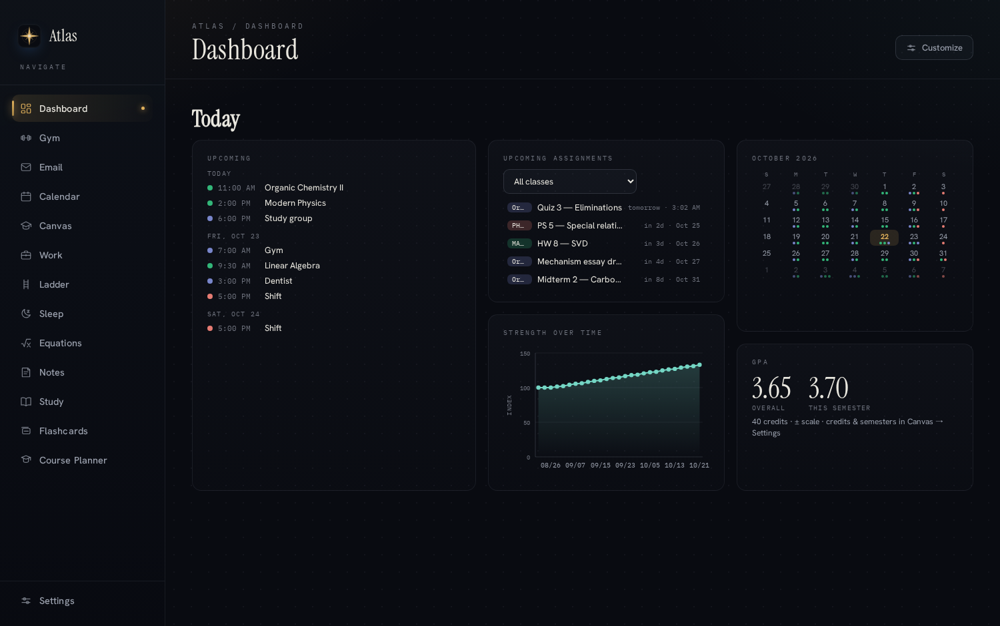
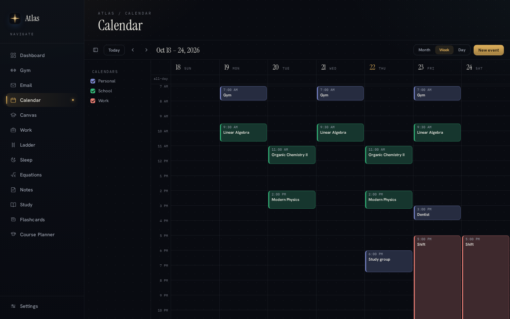
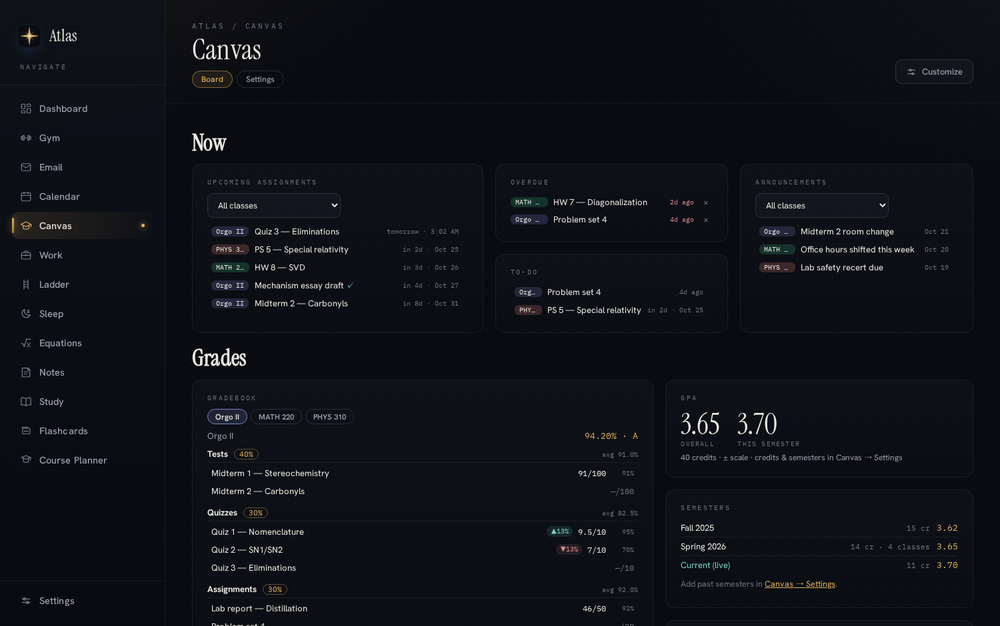
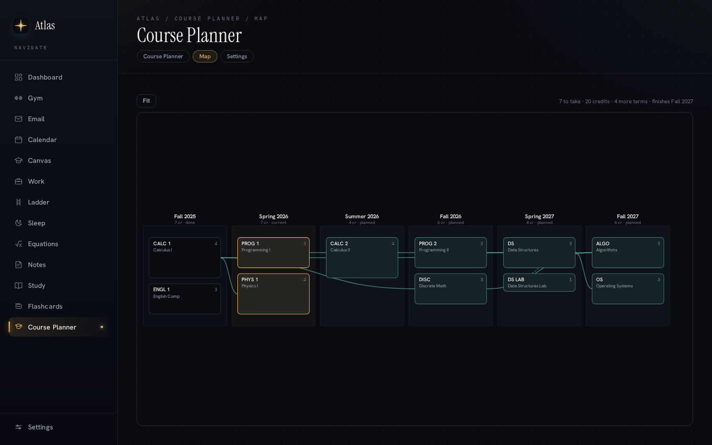
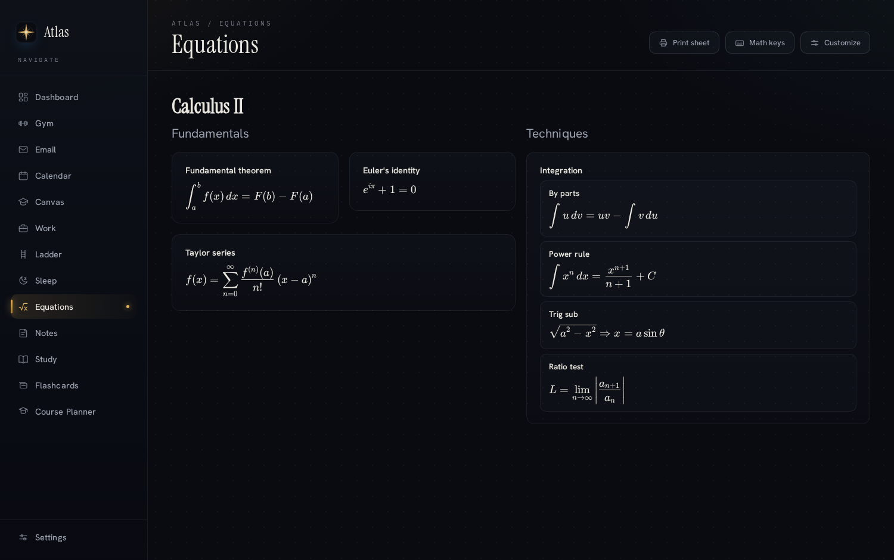
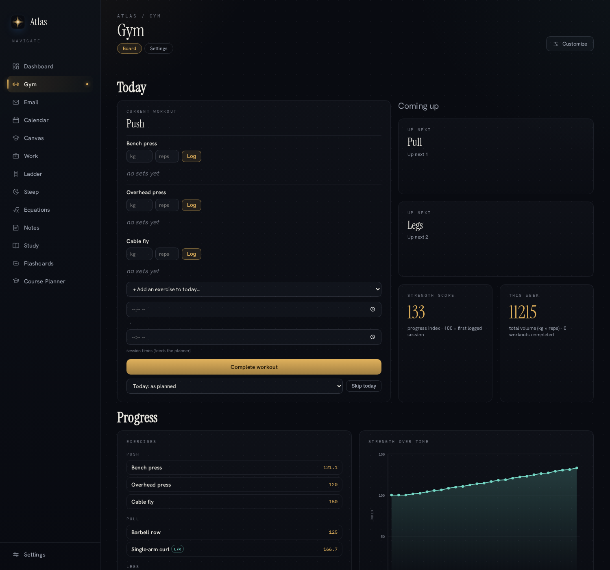
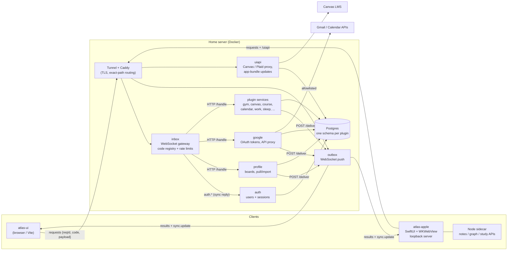
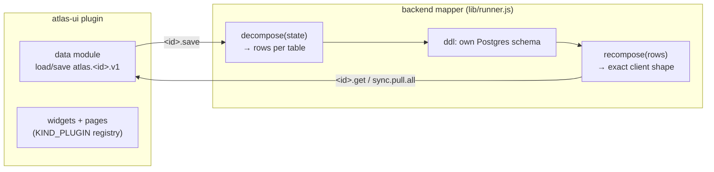

> **Retired project.** Atlas is no longer maintained or deployed; it's kept here as an archive. Its apps live on as the native [Thuban](https://github.com/ChancellorVerdery) suite (Canvas, Desk, Gym, Planner, Study, Graph).

# Atlas

Atlas was a self-hosted "life management" app: one dashboard for a student's calendar, mail, coursework, grades, degree plan, workouts, shifts and sleep. Each area was a plugin. Any plugin's widgets could go on any board. Everything synced across devices through a small backend on a home server. It ran from August to September 2026 as a web app, a native macOS/iOS wrapper and a server console.



<sub>All screenshots show demo data. They come from a production build of `atlas-ui` running in a throwaway container, with every external API (Google, Canvas, the sync backend) mocked.</sub>

## Why

The daily routine was spread across a dozen tabs: Google Calendar, Gmail, the school's Canvas LMS, a spreadsheet degree plan, a notes app for formulas, a workout log, and a notebook for work shifts. Atlas put all of it on boards I could arrange myself. It cross-linked the data, too. The day planner read class times from the calendar, shift times from the work log and drive times from a routing API. The data stayed in a Postgres database I controlled.

## What was in it

| Component | What it was |
| --- | --- |
| **`atlas-ui`**: web app | Vanilla JavaScript + Vite, with no framework. An app shell (sidebar, pages, tabs, theme) and a board engine: rows → columns → sections → lines → widgets, all editable in place with "Customize". Every feature is a plugin that can be turned on or off, or installed from a `.zip`. Its state lives in `localStorage` and is mirrored to the backend. Small Node middlewares handle the Mac-only parts: Apple Notes access, a knowledge-graph builder, and the AI study helpers. |
| **`atlas-backend`**: sync services | Node + Postgres, deployed with Docker Compose. A WebSocket **inbox** takes `{reqId, code, payload}` requests, checks each code against a fixed registry and routes it to the service that owns it. A WebSocket **outbox** sends results and cross-device `sync.update` events back. The **auth** service handles accounts and sessions. **profile** stores board layouts and the full sync pull/import. **google** keeps the server-side OAuth tokens and is the Gmail/Calendar proxy. **uiapi** proxies Canvas and Plaid and serves the native app's update bundle. Each plugin also has its own small service with its own Postgres schema. |
| **`atlas-server-app`**: server console | The home server's control panel: a Caddy config, a Compose stack (Postgres, Portainer, Adminer, Caddy), and one page with tabs for a web terminal (ttyd), Docker, Database and a read-only **Git board**. The Git board is a stdlib Python service that browses the repo's commit history. |
| **`atlas-apple`**: native shell | One SwiftUI target for macOS and iOS. It runs a `WKWebView` over a loopback server built into the app. That server serves the web bundle, passes the session token to the backend proxies, and starts a Node sidecar for the Mac-only APIs. A self-updater downloads new web builds file by file, checks each against a SHA-256 manifest and swaps them in atomically, so UI changes reached the phone without a new Xcode build. |
| **`notes-ink`**: handwriting export | Pure-stdlib Python that reads the stroke data from an Apple Notes "paper" note's SQLite bundle (a CRDT/protobuf format, reverse-engineered here) and renders it to a full-height vector PDF. `notes2pdf.sh` is the GUI-driven alternative: it scripts Notes' own export. |
| **`tools`** | Builds a distributable `.zip` for each plugin (manifest + source) for the install-from-zip flow. |

### Plugins

| Plugin | What it did |
| --- | --- |
| **Calendar** | Google Calendar month, week and day views, an event editor with recurrence, RSVP, and agenda and mini-month widgets |
| **Email** | Gmail inbox, threads, compose, pins and multiple accounts, proxied through the backend so tokens never reach the browser |
| **Canvas** | Canvas LMS grades, weighted gradebook, upcoming/overdue work, announcements, to-dos, and GPA across semesters with per-course letter scales |
| **Course Planner** | Degree planner with prerequisite, corequisite and summer-term rules. A scheduler builds the remaining semesters, and a route map draws the dependency graph |
| **Equations** | LaTeX equation cards and lists (MathLive), with printable formula sheets |
| **Gym** | Workout cycles, set logging, estimated-1RM strength index and weekly volume |
| **Work** | Shifts, tips, projected income and tip-share history |
| **Ladder** | Day planner that puts classes, shifts, sleep and drive times on one timeline |
| **Sleep** | Sleep log, sleep-debt tracking and bedtime guidance |
| **Notes** | Apple Notes browser with Markdown conversion and a knowledge-graph view |
| **Study / Flashcards** | Tutor chat and question bank per course, and spaced-repetition cards pulled from uploaded material. Each user connected their own Claude account for these |

Earlier plugins for **Finance** (Plaid) and a standalone **Graph** view were retired before the end. Their backend mappers are still in `atlas-backend/services/plugins/`.

## Screenshots

| | |
| --- | --- |
|  |  |
| **Calendar**: week view over three Google calendars | **Canvas**: assignments, announcements, weighted gradebook, GPA |
|  |  |
| **Course Planner**: generated semester route with prerequisite links | **Equations**: LaTeX cards and lists, printable as a sheet |

<details>
<summary>Gym board</summary>



</details>

## Architecture



**Sync model.** The client treats `localStorage` as a per-account cache. A wrapper around `setItem` debounces every `atlas.*` write and pushes it to the inbox. Writes made while offline are queued and flushed on reconnect. On boot, a cached layout paints first and the server's copy is pulled in the background. The server sends each change to the user's other devices as `sync.update`. Keys are versioned, so a broadcast never overwrites an edit that is still waiting to be acknowledged.

**Plugin model.** A plugin is two halves that share a storage key:



Each backend mapper is a pure module: a schema, a table list, `decompose` and `recompose`. The shared runner handles HTTP, transactions, row ordering and delivery through the outbox. That keeps mappers testable without a database. Coverage checks round-trip a fixture for each plugin and fail if a field is lost on the way.

## Security design

These are the measures that actually exist in the code:

- **SSH-signature login gate** (`services/gate.js`, `lib/sshsig.js`). The dev server and server console were reachable only after signing a one-time nonce with `ssh-keygen -Y sign` using a key already in the server's `authorized_keys`. Only ed25519 keys are accepted. Nonces are single-use, expire after an hour and are capped in number, so a captured signature can't be replayed.
- **Rate limiting at the only public request surface.** The inbox and outbox throttle new sockets, token lookups, login/signup attempts (10 per IP per 10 minutes), messages per connection and plain HTTP.
- **Accounts.** Passwords are hashed with bcrypt. Session tokens are 32 random bytes, and expiry is enforced in SQL, so clock skew on a caller can't extend a session. Email addresses are normalized, so one address can't become two accounts.
- **OAuth secrets stay server-side.** The Google client secret and user tokens live only in the google service. The browser gets API results, not tokens. The `google.api` proxy only accepts exact Gmail and Calendar URL prefixes, so it can't be used as an open forwarder that carries a bearer token. The Canvas proxy is restricted the same way.
- **Least privilege and loopback binding.** Every service binds to `127.0.0.1` and is published only through the tunnel and Caddy, with exact-path routes (the outbox's internal `/deliver` is not reachable from outside). The internet-facing `uiapi` connects as a database role that can only read sessions and users. Portainer, which effectively holds root through the Docker socket, sat behind Caddy basic auth *and* the SSH gate.
- **Native shell.** The webview can only navigate within its own origin, and external links open in the system browser. Downloaded web bundles are SHA-256-verified against a manifest before they're swapped in. A path-traversal guard is covered by the app's built-in smoke test.
- **Secrets never committed.** `.gitignore` excludes env files, keys and database password files. The real ones lived only on the server.

## How it was built

I designed and directed Atlas: what to build, how it should behave, and what to keep or drop. The code was written with [Claude Code](https://claude.com/claude-code), an AI coding assistant. `NIGHT-NOTES.md` is the engineering log from the unattended overnight passes. Each pass records its baseline test results, the bugs it found and fixed, the negative controls it ran, and the leads it deliberately left alone. Tests are plain Node scripts: `atlas-backend/test/` holds unit tests and checks, `atlas-ui/tests/` holds UI checks, and `atlas-ui/tmp-e2e/` holds headless Playwright end-to-end and screenshot scripts.

## Repository layout

```
atlas-ui/            Vite web app
  src/               app shell, sync client, auth gate
  src/page/          one data module + one UI module per plugin, board engine, theme
  server/            Node middlewares (notes, graph, study/LLM, remote proxies) + sidecar entry
  tests/             UI checks (*.check.mjs)
  tmp-e2e/           Playwright end-to-end and screenshot scripts
atlas-backend/       sync backend
  services/          inbox, outbox, auth, profile, google, uiapi, gate, portainer-auth
  services/plugins/  one mapper per plugin
  lib/               runner, db, rate limiter, sessions, SSH-signature verifier
  migrations/        SQL migrations
  test/              unit tests and checks
atlas-server-app/    server console: Caddyfile template, compose stack, git board, ttyd units
atlas-apple/         SwiftUI macOS/iOS shell, build + asset-deploy scripts, UI tests
notes-ink/           Apple Notes handwriting → vector PDF
tools/               plugin zip builder
notes2pdf.sh         Notes export via GUI scripting
NIGHT-NOTES.md       engineering log
```

## Running it

It isn't runnable as-is, and that's on purpose. Secrets and environment files were never committed. The backend expects a Postgres instance with its roles and password files, a Google OAuth client (ID and secret), and optionally Plaid credentials and a Canvas access token. The deployment assumed a specific home-server setup: tunnel, Caddy and Docker network. The web UI's Mac-only plugins also expect local tools (Apple Notes, `sqlite3`, the Claude CLI). The code is here to read, not to deploy.

---

All rights reserved.
